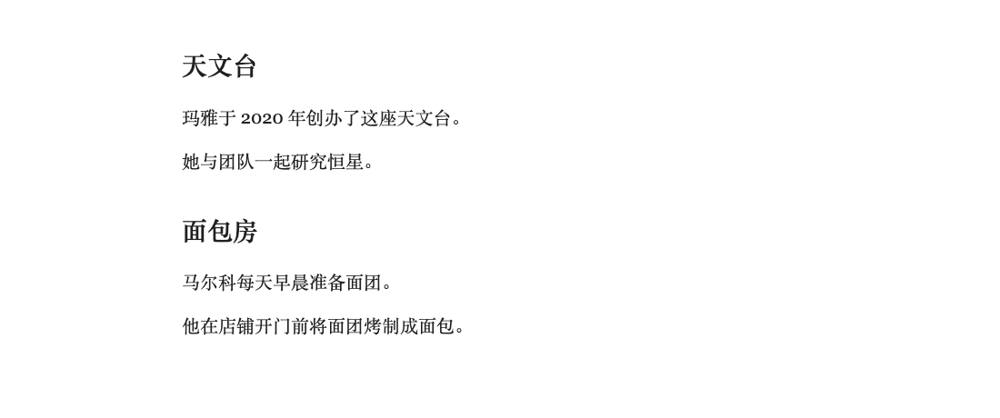
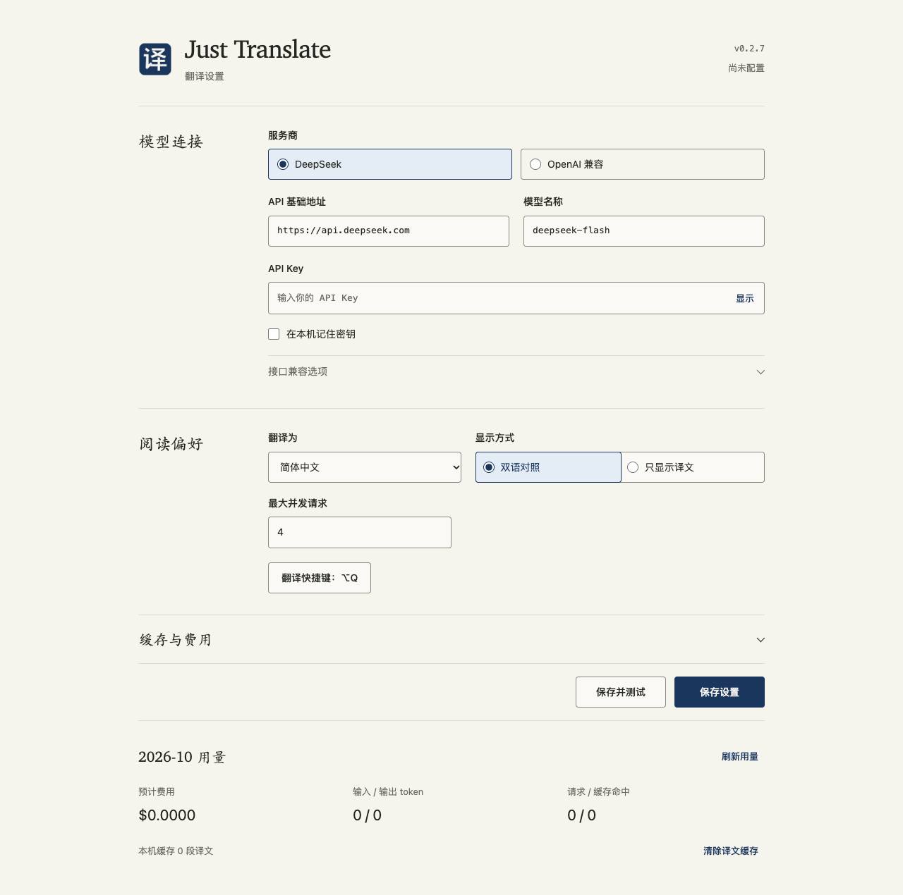

# Just Translate

**用自己的 AI 模型，翻译正在阅读的网页。**

Just Translate 是一个开源 Chrome 翻译插件。接入 DeepSeek 或 OpenAI 兼容服务，按一下快捷键，就能阅读当前页面的译文；继续滚动，新加载的内容也会自动补译。

不需要插件账号，不经过中转服务器。插件本身没有订阅费，模型 API 用量由你选择的服务商计费。

## 为阅读而做

- **双语对照 / 只显示译文** — 对照原文，或专注阅读译文。
- **快捷键切换** — Mac 使用 `Option + Q`，Windows / Linux 使用 `Alt + Q`。按一次翻译，再按一次恢复原文；左键点击工具栏图标只打开设置。
- **跟着页面加载** — 自动处理新段落、展开内容和滚动后加载的正文。
- **段落内 loading** — 在译文将出现的位置显示进度，不用盯着角落等待。
- **保留阅读位置** — 翻译和恢复原文时围绕当前段落调整位置，不强制跳回顶部，也不把你拉回之前读过的位置。
- **相关内容一起理解** — 连续正文共享上下文，不把不同卡片、评论和栏目混在一起。
- **相同按钮共用翻译** — 同页相同的独立文案共用正在进行的翻译；后续副本命中缓存时，不再请求模型。
- **自己的模型、自己的用量** — 支持自定义 API 地址和模型，提供译文缓存、用量记录及费用上限。



## 开始使用

目前通过「加载已解压的扩展程序」安装，尚未提供 Chrome 应用商店版本。

需要 **Chrome 120+**，安装发布包无需 Node.js。

1. 从 [GitHub Releases](https://github.com/justdoswift/just-translate/releases/latest) 下载名称以 `-chrome.zip` 结尾的插件包，解压到固定目录。不要选择 GitHub 自动生成的 `Source code`。
2. 打开 `chrome://extensions`，开启「开发者模式」。
3. 点击「加载已解压的扩展程序」，选择包含 **`manifest.json`** 的解压目录。
4. 将 Just Translate 固定到工具栏，左键点击图标打开设置。
5. 填写模型连接，点击「保存并测试」，允许访问模型 API 域名。
6. 回到要阅读的普通网页，按 `Option + Q`（Mac）或 `Alt + Q`（Windows / Linux）开始翻译。

翻译进行中再次按快捷键，会停止任务并恢复原文；已翻译时再次按，也只恢复原文，不叠加新译文。

更新时，将新发布包解压到原插件目录，在扩展管理页重新加载插件，**再刷新网页**。请保留插件目录；删除它会导致插件无法加载。

### 连接模型

| | DeepSeek | 其他 OpenAI 兼容服务 |
| --- | --- | --- |
| 服务商 | 选择 DeepSeek | 选择 OpenAI 兼容 |
| API 基础地址 | `https://api.deepseek.com` | 服务商提供的基础地址 |
| 模型 | 默认 `deepseek-flash` | 服务商支持的模型名称 |
| API Key | 你自己的 DeepSeek Key | 对应服务商的 Key |

基础地址不要包含 `/chat/completions`。其他服务需兼容 Chat Completions；本机服务可使用 `localhost` 或 `127.0.0.1` 的 HTTP 地址。

「保存并测试」会翻译一小段文字，产生少量 API 用量。测试失败不会覆盖上一次可用配置。

### 选择阅读方式

在 **阅读偏好 → 显示方式** 选择「双语对照」或「只显示译文」，保存后回到网页重新开启翻译。

仅译文模式会等整段成功后再隐藏原文。尚在加载或翻译失败时，原文仍然可读；失败段落可以单独重试。

按钮、短链接标签，以及带省略号或行数限制的卡片文字，在两种模式下都采用原位译文。卡片保留原有的文字截断方式，不为了展示完整译文而挤压按钮；正文仍按所选模式显示。

快捷键未生效？打开 `chrome://extensions/shortcuts`，找到 Just Translate 的 **「切换原文 / 译文」**，设置 `Option + Q` / `Alt + Q`。Chrome 必须处于当前活动窗口。

### 调整翻译速度

在 **阅读偏好 → 最大并发请求** 设置 `1–8`，默认 `4`。这个上限由所有正在翻译的标签页共用，不是每页各开一组。

只修改并发数时，保存后立即生效，不用重开翻译。调低上限会等已发出的请求完成，不中断或重发；服务商返回限流时，会暂时降速，成功响应后逐步恢复。

在途请求暂时占用预算时，先等待结算再继续；不会把预留额度当成已花完，也不会自动提高费用上限。

缓存命中和正在翻译的相同独立文案，不必等慢请求空出名额。提高并发不代表等比例提速：模型响应速度、服务商限流和浏览器连接数仍会影响等待时间。

### 安静的设置页

设置页和图标参考 [Kami](https://kami.tw93.fun/index-zh.html) 的暖纸色与墨蓝风格，支持深色外观和窄窗口。图标为原创绘制，字体使用系统字体，不加载远程资源。



配置保存失败时，保留原连接和正在阅读的译文。配置已保存但清理失败时，会明确提示「已保存，需重载」，不会让你误以为修改没有生效。

## 关于上下文

不是一句话发一次请求。插件以段落为单位提取文字，把同一内容区域中的连续正文按阅读顺序交给模型；特别长的段落才会拆分。首屏正文先用小批次返回，后续恢复较大批次，并优先处理正在阅读的位置。

不同文章、卡片、评论和栏目分开处理。新增段落或跨批翻译只带同组附近的少量上下文，不反复发送整页。相邻内容重复时，会向同组内寻找不同的上下文；无法从页面结构确认关联时，宁可分开翻译。

这是保守的页面结构判断，不是对内容含义的完美理解。上下文会增加少量输入用量，隔离内容也可能增加请求数；译文质量和实际费用取决于模型服务商。

相同独立文案会复用结果，正在翻译的副本也会共用请求。正文仍按上下文区分，连接配置和目标语言也参与缓存隔离。首次翻译仍需等待模型返回。

## 隐私与费用

- 只在你手动开启的页面工作，不自动翻译所有标签页。
- 正文和必要上下文直接发送到你配置的模型服务商，Just Translate 没有中转服务。
- API Key 不交给网页，也不使用 Chrome 同步。默认只保留到浏览器关闭或插件重新加载；可以选择「在本机记住密钥」。
- 本机密钥存储不是加密保险箱，请谨慎在共享设备上启用。
- 译文缓存默认只在当前浏览器会话内保留，可选择持久缓存并随时清除。
- 用量与费用是估算，不是服务商账单。使用自定义服务的费用上限前，请填写对应的输入、输出单价。

## 适用范围

适合普通网页中的文章和可读文本。暂不支持 PDF、图片文字识别、Canvas、iframe 内文、Shadow DOM 和 Chrome 内部页面，也不承诺翻译网站上的每一个菜单或控件。

译文按纯文本显示，段内链接和强调格式不会映射到译文；需要访问段内链接时，可先切回原文。整张卡片或按钮本身的点击行为会保留。

不做划词翻译、悬浮词典和聊天侧栏。

## 一起改进

遇到漏译、排版问题或模型兼容问题，欢迎提交 [Issue](https://github.com/justdoswift/just-translate/issues)。附上页面链接、Chrome 版本和复现步骤会更容易定位；**不要上传 API Key 或私密网页内容**。

也欢迎提交 Pull Request。改进网页兼容性、翻译体验或文档都很有帮助。

<details>
<summary>本地开发</summary>

从源码构建需要 **Node.js 22.12+**：

```sh
git clone https://github.com/justdoswift/just-translate.git
cd just-translate
npm ci
npm run build
npm run typecheck
npm test
```

构建后，在 Chrome 扩展管理页加载 **`.output/chrome-mv3`**；`npm run dev` 用于本地开发。

浏览器回归使用独立的临时配置和本机测试 API，不读取个人 Chrome 数据。各测试文件串行运行，避免多个 Chromium 实例争抢资源；多标签页场景在同一浏览器内验证。

```sh
npx playwright install chromium
npm run test:chrome
```

技术栈：TypeScript、WXT、Chrome Manifest V3。模型响应只按文本渲染，不执行返回的 HTML 或脚本。

</details>

## License

[MIT](LICENSE) © 2026 Ge Peng。允许使用、修改、商用和再发布，保留原版权与许可声明即可。
